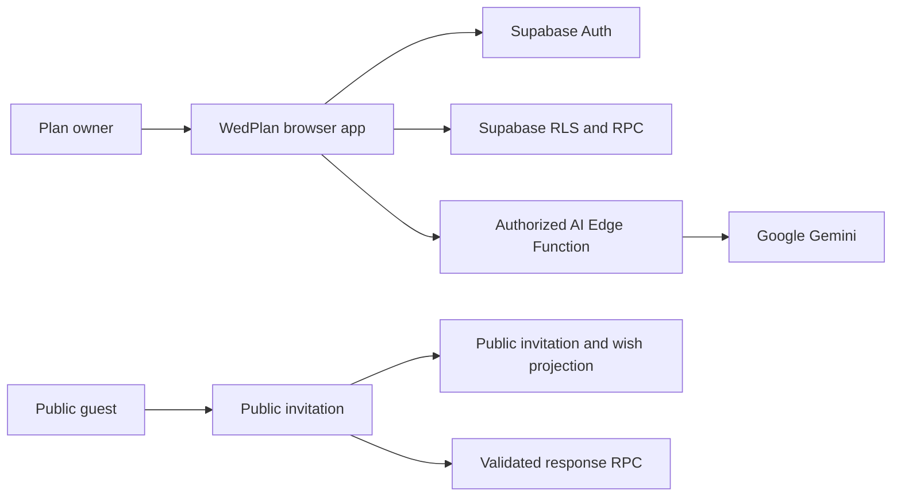
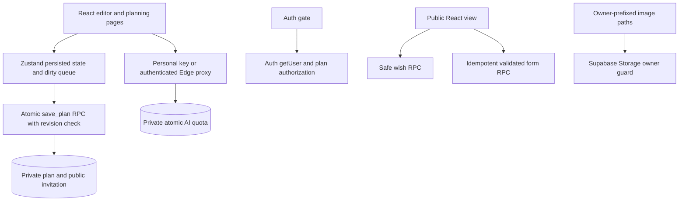
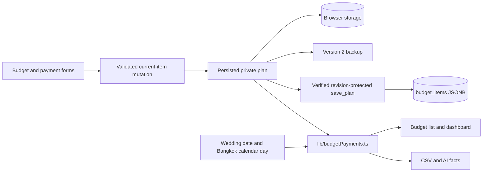

# Architecture — WedPlan AI 2.4.0

Updated: 2026-11-03. Planning workflow changes build on the audit fix branch; production application of SQL/secrets remains a deployment gate.

## Diagram applicability

| Type | Applicability | Rationale |
|---|---|---|
| System context | required | Distinguish owner, public guest, Auth, Data API and AI service |
| Containers | required | Show local state, revision-protected RPC, public projection and server quota |
| Deployment topology | optional, omitted | Supabase + a static Vercel host; deployment instructions are in SETUP.md |
| Distributed queue | N/A | No cross-service queue; browser serializes its own pending saves |

## System context

Diagram source: `.viepilot/architecture/system-context.mermaid`

## Containers

Diagram source: `.viepilot/architecture/containers.mermaid`

## Boundaries

- The legacy plan UID remains a public identifier, not a credential. Private owner mapping is writable only by database administrators.
- Auth/RLS protects owner data. Public clients receive invitation content and a wish projection without phone/email, plus a bounded/idempotent form submission RPC.
- System AI requests require a verified Auth user and permission for the server-configured owner plan. No service-role key is required in frontend or Edge handler.
- Private/public invitation saves share a transaction. Exact database revisions are retained as strings; failed reads and stale revisions cannot enable silent replacement.
- Export/import validates a complete versioned plan snapshot. Auth tokens and personal keys are excluded.
- Dashboard milestones live in the same persisted plan and private JSONB snapshot as guests/budget. The old browser-only key is read only for migration after a verified remote read; server tasks take precedence. Explicit column selection fails safely against an outdated schema.
- Guest phone, invitation status, notes and table names stay in private plan JSON, never in the public invitation projection. Attendee totals include companions and children once.
- The optional local-preview tool intercepts API calls in a separate Chrome context with sample data. It adds no authentication bypass or demo mode to production app code.
- Owner preference: personal PIN gate is the frontend default; account login is opt-in. PIN unlock is not a database credential. Missing cloud session/configuration selects explicit local-only persistence with accurate Save messaging; private RLS still requires a separately verified owner session.

## Budget ledger — 2.4.0

Diagram source: `.viepilot/architecture/budget-payments.mermaid`.

- `agreedCost?` distinguishes no price from explicit zero. Legacy `actualCost` is retained for reconciliation, never treated automatically as paid cash or contract price. Missing ledger arrays require explicit reconciliation; no automatic payments from task status.
- `paymentSchedule[]` stores stable stage IDs, integer VND, labels and `offsetDays` relative to the wedding. Settled stages retain their historical due-date snapshot; pending due dates move with the wedding. `payments[]` stores stable IDs, deposit/payment kind, actual paid date, allocations, notes and optional void time/reason. Actual cash dates never move with the wedding.
- One pure validated helper derives all totals. Deposits are a subset of paid. Confirmed debt sums per-item nonnegative balances of reconciled, priced items; provisional balances and overpayments are separate. Before/on + after + unscheduled reconciles to confirmed debt. Overdue/next-seven-days are overlapping views of that debt, not additional liabilities.
- Current-item store mutations avoid overwriting concurrent new payment history with a stale metadata form. Validation precedes state replacement/backup import/cloud saves and reads. Failed cloud writes retain dirty state; existing revision checks prevent stale writes.
- Existing private JSONB and `save_plan` round-trip the extensions without SQL changes. No fields are added to public invitations. There is no banking/payment execution API, refund workflow or automatic reminder service; void only corrects entered records and retains history.
