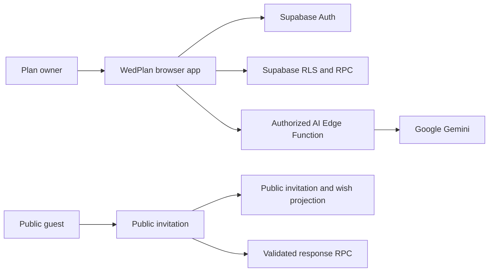
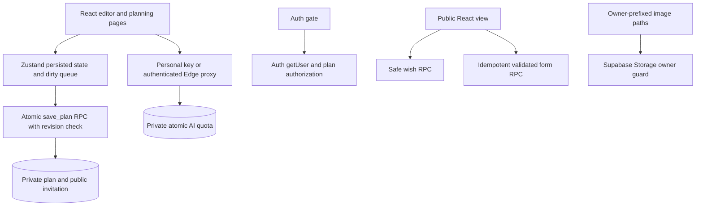

# Architecture — WedPlan AI 2.2.1

Updated: 2026-11-03. Runtime changes are implemented on the audit fix branch; production application of SQL/secrets remains a deployment gate.

## Diagram applicability

| Type | Applicability | Rationale |
|---|---|---|
| System context | required | Distinguish owner, public guest, Auth, Data API and AI service |
| Containers | required | Show local state, revision-protected RPC, public projection and server quota |
| Deployment topology | optional, omitted | Supabase + a static Vercel host; deployment instructions are in SETUP.md |
| Distributed queue | N/A | No cross-service queue; browser serializes its own pending saves |

## System context

Diagram source: `.viepilot/architecture/system-context.mermaid`

## Containers

Diagram source: `.viepilot/architecture/containers.mermaid`

## Boundaries

- The legacy plan UID remains a public identifier, not a credential. Private owner mapping is writable only by database administrators.
- Auth/RLS protects owner data. Public clients receive invitation content and a wish projection without phone/email, plus a bounded/idempotent form submission RPC.
- System AI requests require a verified Auth user and permission for the server-configured owner plan. No service-role key is required in frontend or Edge handler.
- Private/public invitation saves share a transaction. Exact database revisions are retained as strings; failed reads and stale revisions cannot enable silent replacement.
- Export/import validates a complete versioned plan snapshot. Auth tokens and personal keys are excluded.
